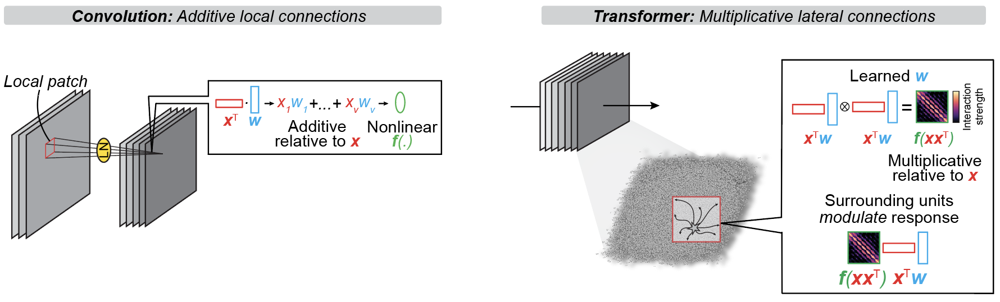
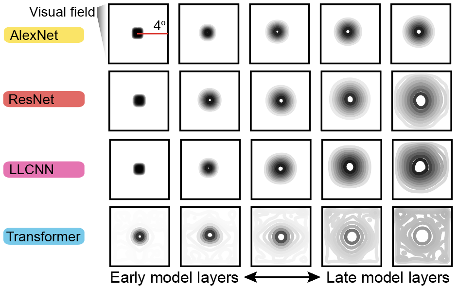

# Part 1: How different (or similar) are transformers from convolutional neural networks?

Yash Shah  
Nov 13, 2026

In [Part 0](part0.md), I introduced the transformer as a candidate model of cortical computation. Transformers are often thought to poorly approximate computations in the cortex because of their purportedly global attention mechanism, which allows every unit in a layer to interact with every other unit. Here, we argue that this skepticism is not only based on an incomplete picture of how transformers actually compute, but also obscures fine-grained similarities between transformers, convolutional neural networks (CNNs), and the brain.

## Computations performed by single units

A CNN is built around an **additive microcircuit**. Each unit combines inputs from a local neighborhood through a weighted sum, followed by a nonlinear transformation. As this operation is repeated across layers, information is progressively integrated over larger regions of the image.

A transformer uses two complementary operations.

The first is an **additive multilayer perceptron (MLP)**. Like a 1 × 1 convolution, the MLP applies the same learned transformation independently to each token. Each token represents a local patch of the input image, and the MLP transforms the features carried by that patch without directly combining information across different tokens.

The second is a **multiplicative attention mechanism**. A self-attention module first computes relationships between pairs of tokens, producing an attention matrix. This matrix determines how strongly information from each token contributes to the updated activity of every other token. In this way, self-attention allows the network to dynamically route information between different image regions. Unlike the fixed local filters in a CNN, these interactions are learned and depend on the current input.

So the key architectural difference is not simply that CNNs are local and transformers are global. Rather, **CNNs primarily combine information through additive operations, whereas transformers combine additive processing with learned multiplicative interactions between tokens.**

What might be the biological analogues of these multiplicative interactions? Context-dependent gain modulation ([Salinas & Thier, 2000](https://www.sciencedirect.com/science/article/pii/S0896627300000040)) and long-range lateral interactions ([Gilbert et al., 1993](https://www.pnas.org/doi/abs/10.1073/pnas.90.22.10469)) are both well-documented features of mammalian cortex. These phenomena provide potential biological routes for context-dependent interactions between neural populations.

Given that transformers can integrate information across distant image regions, one might expect them to develop very different representations from CNNs. CNNs have an explicit bias toward locality: early layers process small image regions, and progressively deeper layers combine information over larger areas. Standard transformers have no such restriction. Their attention mechanisms can, in principle, connect distant image regions from the very first layer.

But do these differences in the computations of individual units actually produce different organization at the population level?

## Computations performed by populations of units

The primate visual system is organized [retinotopically](https://physoc.onlinelibrary.wiley.com/doi/10.1113/jphysiol.1962.sp006837) and [hierarchically](https://www.nature.com/articles/nn1100_1199). As a consequence, populations of neurons at successive stages of the visual hierarchy integrate information over increasingly large regions of visual space, creating a [progression from local to global representations](https://www.cell.com/current-biology/references/S0960-9822(14)01653-4).

CNNs naturally develop this organization. Architectural parameters such as kernel size, stride, and pooling determine how receptive fields grow with network depth. Transformers, however, present a puzzle. Because attention can connect distant image regions, their theoretical receptive fields can span the entire image at every layer. Does this remain true after transformers are trained on natural images?

To answer this, we measured *effective population receptive fields* by computing the Jacobian of unit responses with respect to the input image. This allowed us to characterize which regions of the visual field actually influence each unit's response.

**Transformers developed a clear local-to-global receptive field hierarchy, despite having the architectural capacity to integrate information globally from the start.**

## Sparse long-range lateral connections

How is it possible that transformers develop a hierarchical receptive field structure despite having access to information from across the entire image?

We visualized the learned attention matrices and found that **units do not connect uniformly to all other units in a layer**. Instead, most interactions are local, regardless of where a layer sits in the model hierarchy, with a smaller number of sparse long-range interactions.

In other words, having the capacity for global communication does not mean that a transformer uses it everywhere. Training produces a structured pattern of interactions: predominantly local, but with selective connections to more distant parts of the image.

## What does this tell us?

I hope I've convinced you that transformers are not as different from convolutional networks as their architectures might initially suggest. Like CNNs, they develop hierarchical, retinotopic representations and a local-to-global receptive field structure. Even their attention patterns are predominantly local, with only a sparse set of longer-range interactions.

Transformers do differ from CNNs in two meaningful ways: (1) they support sparse long-range interactions between units, and (2) they incorporate learned, context-dependent multiplicative operations alongside the additive operations that are central to CNNs.

What purpose do these differences serve? And what do they allow transformers to explain about the brain that CNNs cannot?

Stay tuned!

---

Reach me by  
email: ynshah [at] stanford [dot] edu  
bluesky: @ynshah.bsky.social  
linkedin: @ynshah3  
x: @itsysxx