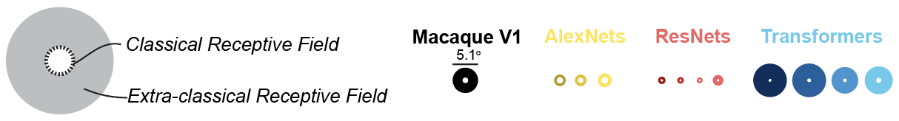
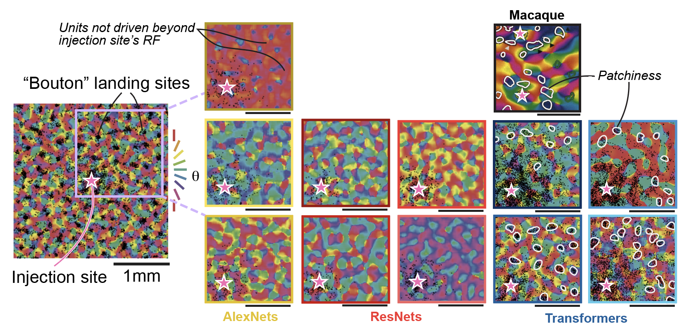

# Part 2: Transformers capture the fine details of local cortical circuitry

Yash Shah  
Nov 20, 2026

In [Part 1](part1.md), I showed that transformers are not so different from CNNs. Both develop hierarchical, retinotopic representations and rely primarily on local interactions. Transformers, however, also develop sparse long-range lateral connections. Can these connections help transformers better capture the fine details of cortical circuitry?

## Both transformers and CNNs develop the right receptive fields at the population level. But what happens at the unit-level?

Neurons in primary visual cortex (V1) have relatively small [classical receptive fields](https://www.jneurosci.org/content/22/19/8633.long): regions of visual space where a stimulus directly drives their activity. Both CNNs and transformers develop similarly localized classical receptive fields.

But cortical neurons also respond to stimuli outside these regions. These broader [extra-classical receptive fields](https://www.jneurosci.org/content/22/19/8633.long), or surrounds, modulate a neuron's response even when the surrounding stimulus does not drive it directly.

**Transformers are the only model class that captures these extra-classical receptive fields**, suggesting that their sparse, learnable lateral connections are important for reproducing this aspect of cortical function.

## Beyond capturing unit-level computation, only transformers predict local iso-orientation specificity circuitry of lateral connections

If lateral connections help transformers develop extra-classical receptive fields, how are these connections themselves organized?

In monkey V1, lateral connections have been mapped by tracing the [retrograde transport of biocytin from labeled boutons to their sites of origin](https://www.pnas.org/doi/abs/10.1073/pnas.90.22.10469). This reveals a patchy organization: connections link spatially separated groups of neurons with similar orientation preferences.

We performed our own *virtual* bouton-transport experiment in the models. **Transformers were the only models to reproduce both the patchy organization and orientation specificity of cortical lateral connections.** CNNs, which lack lateral connections, have no corresponding pattern of connection sites.

## Transformers capture cortical circuitry down to the level of individual neurons

These results show that transformers capture fine-grained properties of how individual units compute and organize their connections.

In the next part, we'll ask whether this correspondence extends beyond local circuitry to predicting large-scale, multi-area electrophysiology data.

---

Reach me by  
email: ynshah [at] stanford [dot] edu  
bluesky: @ynshah.bsky.social  
linkedin: @ynshah3  
x: @itsysxx